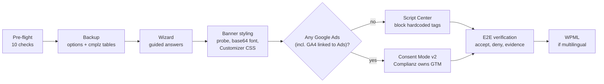

# Complianz Deploy: a Claude Code skill for WordPress cookie banners

[](LICENSE)


A field-tested playbook that teaches [Claude Code](https://code.claude.com/docs/en/overview)
to deploy, style and verify the [Complianz](https://complianz.io/) GDPR cookie consent banner on a
WordPress site, end to end. The goal is a full deployment in about an hour instead of an afternoon
of trial and error.

Created by **Fafarafiel**, [iD4.pl](https://id4.pl).

It packs the lessons of ten production deployments into one workflow: a pre-flight that catches
problems before you touch the wizard, the exact wizard answers, a banner that looks native to the
site, blocking of hardcoded trackers, Google Consent Mode v2, WPML, and a verification pass that
produces evidence instead of "should work".

---

## Contents

- [Why this exists](#why-this-exists)
- [What it does](#what-it-does)
- [How it works](#how-it-works)
- [Requirements](#requirements)
- [Installation](#installation)
- [Usage](#usage)
- [Standalone scripts](#standalone-scripts)
- [House rules (safe defaults)](#house-rules-safe-defaults)
- [Repository layout](#repository-layout)
- [Scope and compatibility](#scope-and-compatibility)
- [Security notes](#security-notes)
- [Troubleshooting](#troubleshooting)
- [Contributing](#contributing)
- [Author](#author)
- [Disclaimer](#disclaimer)

## Why this exists

Complianz is a solid consent plugin, but deploying it well is full of traps that cost hours:

- the admin panel is a React SPA whose REST nonce expires, so saves look successful and silently
  vanish (the classic "why is the banner not showing");
- the plugin does not block Google Tag Manager when it is hardcoded in the theme;
- the Consent Mode v2 switch only appeared when Complianz itself adds GTM (observed on 7.5.2);
- on 7.6.0 the plugin's own Custom CSS editor was seen storing the CSS but never outputting it;
- WPML registers the banner strings with the wrong source language;
- a banner styled only by its Accept color looks like a foreign widget on the site.

Every one of these was hit on a real site. This skill makes Claude check for them up front, so each
new deployment starts where the last one ended.

## What it does

| Area | What you get |
|---|---|
| **Pre-flight** | 10 checks before the wizard: plugin version and Free vs Premium conflicts, policy pages, tracking stack (including Elementor Custom Code snippets), Google Fonts source, WPML, WAF and REST access, design tokens, admin locale, work channels (SSH, WP-CLI, file access), session stability. One batched question to the site owner instead of a stream of interruptions. |
| **Wizard** | Screen-by-screen answers for the Complianz wizard (regions, documents as "Existing page", statistics, services, Records of Consent), including which buttons NOT to click. |
| **Banner design match** | A design probe reads the site's real buttons (font, weight, letter case, radius, solid vs ghost, colors). If the brand font is a Google Font that Complianz blocks before consent, the font is embedded as base64 so the banner still renders in it. CSS is injected through the WordPress Customizer, with a front-end read-back. |
| **Tracker blocking** | Script Center procedure for hardcoded GTM and the Elementor Google Maps widget, plus fixes for what Complianz does not detect: Vimeo background video (Elementor privacy mode), WooCommerce order attribution (sets cookies before consent unless gated through the WP Consent API: switched off, or proven to wait), payment SDKs (documented in the policy). |
| **Consent Mode v2** | The path for sites running Google Ads: move GTM ownership to Complianz, switch hardcoded copies off reversibly, audit the container for non-Google tags, verify all four consent signals (`ad_storage`, `analytics_storage`, `ad_user_data`, `ad_personalization`) the way Google's guide does, plus the `gcs` parameter on Google hits (`G100` before consent, `G111` after). |
| **Multilingual** | Zero-downtime WPML fix (correct the string source language, then translate in bulk through the WPML endpoint). |
| **Verification** | `verify.sh` for the HTML layer plus a browser E2E (opt-in regions; opt-out regions such as the US have their own checklist): no tracker requests before consent on the blocking path (on the Consent Mode path only cookieless Google pings and no tracking cookies), accept fires, deny stays silent (Consent Mode path: cookieless Google pings may continue), decision remembered. Ends in a verification table and a screenshot. |
| **Knowledge base** | 59 documented gotchas with causes and fixes, from nonce handling to host page caches and rate limits. |

## How it works



Claude Code loads `SKILL.md` when your request matches its description (for example "deploy
Complianz on example.com"). `SKILL.md` holds the workflow and the short trap list; the detailed
procedures live in `references/` and are read only when a step needs them, so the skill stays light
on context. The scripts in `scripts/` do the parts that must be exact: checking the HTML, probing the
design, embedding fonts and injecting CSS.

## Requirements

| Requirement | Why | Notes |
|---|---|---|
| [Claude Code](https://code.claude.com/docs/en/overview) | runs the skill | any recent version with skills support |
| [dev-browser](https://github.com/SawyerHood/dev-browser) | drives the Complianz React admin and runs the browser checks | `npm install -g dev-browser && dev-browser install` (installs Chromium). Playwright MCP also works for driving the wizard; the scripts need dev-browser |
| Python 3.8+ | every script (`verify.sh` and `run-design-probe.sh` call it too) | standard library only |
| bash + curl | `verify.sh`, `run-design-probe.sh` | macOS and Linux; works with the macOS default bash 3.2 |
| Node.js 18+ and npm | installs dev-browser; runs the offline tests | required for dev-browser |
| WordPress admin access | the wizard and the Customizer | Complianz Free or Premium installed |
| SSH / WP-CLI | backup, reading options, CLI wizard | optional but strongly recommended |

## Installation

**Option A: personal skill (available in every project)**

```bash
git clone https://github.com/fafarafiel/Complianz-skill.git ~/.claude/skills/complianz-deploy
```

**Option B: project skill (shared with a team through the repository)**

```bash
git submodule add https://github.com/fafarafiel/Complianz-skill.git .claude/skills/complianz-deploy
```

(A plain `git clone` inside a project repository would be committed as an empty link, so teammates
would get an empty folder. Teammates run `git submodule update --init` once after pulling, or clone
the project with `--recurse-submodules`. To vendor a copy instead, clone it and delete its `.git`
folder before committing.)

**Option C: manual copy.** Download the ZIP from GitHub and place the folder so that the path is
`~/.claude/skills/complianz-deploy/SKILL.md`.

Then install the browser tool once:

```bash
npm install -g dev-browser
dev-browser install
```

**Check the installation:**

1. Start a new Claude Code session so the skill is picked up (see the
   [skills documentation](https://code.claude.com/docs/en/skills) for where skills live).
2. Ask: *"Which skills do you have for cookie banners?"* Claude should list `complianz-deploy`.
3. Optional: run the offline tests from the skill folder:

   ```bash
   cd ~/.claude/skills/complianz-deploy && bash tests/run-tests.sh   # Option B: cd .claude/skills/complianz-deploy
   ```

**Update later:** `git -C ~/.claude/skills/complianz-deploy pull` (Option B:
`git submodule update --remote .claude/skills/complianz-deploy`)

## Usage

Just describe the job. Example prompts:

- *"Deploy Complianz on https://example.com. Policy pages already exist."*
- *"Why is the Complianz banner not showing on https://example.com?"*
- *"Google Ads asked the client to fix their consent banner; the site has Complianz and GTM in Elementor."*
- *"Match the Complianz banner to the site's buttons and verify it."*
- *"Verify the Complianz setup on https://example.com and give me the evidence."*

What to expect during a full deployment:

1. Claude runs the pre-flight and shows you a findings table with **one** question covering the
   decisions only you can make (visitor regions, blocking vs Consent Mode, Records of Consent, banner
   position, Google Fonts).
2. It backs up the options and Complianz tables (when it has WP-CLI), then walks the wizard with a
   fresh nonce and reads every save back.
3. It probes the site's design, builds the banner CSS, injects it through the Customizer and checks
   the front end.
4. It blocks hardcoded trackers or sets up Consent Mode v2.
5. It verifies end to end and reports a table of criteria with evidence, plus a screenshot.

Give it credentials the way you normally do in Claude Code (for example environment variables or a
logged-in dev-browser profile). The skill does not store them; the one exception is the `apply.js`
file you generate yourself with credentials set (see Security notes).

## Standalone scripts

All scripts work on their own, without Claude.

### `scripts/verify.sh`: HTML-level check

```bash
bash scripts/verify.sh https://example.com
bash scripts/verify.sh https://example.com googletagmanager.com/gtm.js "fbq('init'" fonts.googleapis
```

- **Fails on:** front end not 200, no Complianz scripts, no banner container, a tracker that is live
  before consent in a `<script>`, `<link>`, `<iframe>`, `` or other media tag. Every occurrence of
  each tracker is checked: a script must be `type="text/plain"`; a link, iframe or media tag must carry
  the URL in a Complianz attribute (`data-src-cmplz` or `data-cmplz-src`, or `data-href` on a tag
  marked `data-category` / `data-service`). Any other `data-` attribute (`data-src`, `data-lazy-src`, delayed styles) belongs
  to a lazy-loader or optimizer and fails, because it loads on scroll or interaction without consent.
  HTML comments are ignored. The first live tag is printed.
- **Warns on:** a redirect to another host or path (or a downgrade from https to http), position other than bottom-right, no opt-in marker, a
  tracker not found at all, only resource hints (`dns-prefetch`, `preconnect`) found, an occurrence
  outside script, link or media tags such as an inline `@import` (reported as not classified;
  the result then says "with unclassified occurrences"), occurrences only inside `<noscript>`
  fallbacks, a policy link not answering 200, a `<noscript>` GTM fallback.

Exit code 0 = pass, 1 = fail, 2 = usage error. TLS is verified; `CMPLZ_INSECURE=1` skips it for a
staging site with a self-signed certificate. On the Consent Mode v2 path pass a tracker list without
`googletagmanager.com/gtm.js` and `googletagmanager.com/gtag/js`, because Google tags loading before
consent is correct there. This is the HTML
layer only; the browser network audit in `references/golden-path.md` section 4 is the authoritative
check.

### `scripts/run-design-probe.sh`: the site's design tokens

```bash
bash scripts/run-design-probe.sh https://example.com/ --headless
```

Prints JSON with the computed styles of the site's buttons, the most common button style, the fonts
the banner may copy (body text and every button font) and whether the page loads each one before
consent, which Google Fonts Complianz blocks, and the current banner buttons. The probe clears cookies to see the site as a first-time visitor, so it always runs in its
own dev-browser instance (`cmplz-probe` unless you pass `--browser <name>`) and refuses `--connect`;
your logged-in pages are not touched. Other extra arguments go to dev-browser.

### `scripts/font-to-base64.py`: brand font that renders before consent

```bash
python3 scripts/font-to-base64.py "Nunito" "300 700" NunitoBanner > fontface.css
python3 scripts/font-to-base64.py "Nunito" "600" --subsets latin,latin-ext > fontface.css
```

Downloads a Google Font and prints `@font-face` rules with the font embedded as base64. Same origin, no
request to Google, so it works before consent. A weight range needs a variable font (for a static font
the script embeds the first weight and says so). Add `latin-ext` for letters used in many European
languages; each subset gets its own rule with a `unicode-range`.

### `scripts/apply-banner-css.py`: inject the banner CSS

```bash
( umask 077; CMPLZ_URL=https://example.com/ python3 scripts/apply-banner-css.py banner.css > apply.js )
dev-browser --timeout 120 < apply.js
rm apply.js
```

Generates a dev-browser script that opens the Customizer, finds the theme's Additional CSS setting
(`custom_css[<theme>]`), replaces only its own marked block (the rest of the site's CSS is untouched),
publishes, and then loads the front end to count the rules that actually arrived (it fails with
`FRONT_CHECK_FAILED` if they did not). Before changing anything it saves the current Additional CSS to
`~/.dev-browser/tmp/cmplz-custom-css-backup-<timestamp>.css`, and it stops with `PENDING_CHANGES` when
the Customizer holds other unpublished changes. It reuses the dev-browser profile's wp-admin session;
if it stops with `NOT_LOGGED_IN`, either set `CMPLZ_USER` and `CMPLZ_PASS` (they are typed only into a
login page under `CMPLZ_URL`; anything else stops with `LOGIN_ORIGIN_MISMATCH`, so use the site's
canonical host, with or without `www`) or log in once by hand:

```bash
dev-browser --browser default <<'EOF'
const page = await browser.getPage("cmplz_apply_css");
await page.goto("https://example.com/wp-login.php");
EOF
```

then log in by hand in the browser window that opens (named pages keep their session in the
dev-browser daemon; if no window appears because the instance was started headless, run
`dev-browser stop`, which closes all its instances, and run the snippet again).

`apply-banner-css.py` accepts only `https://` URLs
(`CMPLZ_ALLOW_HTTP=1` for a local test site) and refuses CSS containing `<` or `>` (sanitizing filters
on some sites eat such text and the save still reports success). Block themes have no Customizer
Additional CSS; there use Site Editor > Styles > Additional CSS or a WPCode CSS snippet. A CSS
optimizer that combines inline CSS (LiteSpeed Cache, WP Rocket, Autoptimize) can make the front-end
check fail even after a good publish: purge or exclude it and check again.

## House rules (safe defaults)

These defaults are written into `SKILL.md`. Edit that section if your policy differs.

- **No legal documents are generated.** The banner links the site's existing policy pages. Claude
  does not click "Update pages" (it renames the site's pages) and does not edit policy content
  without explicit approval. The exceptions, each on the site owner's explicit request, are the
  cookie policy that Complianz generates and, for a US region, its generated opt-out page.
- **The website scan is not started.** "Start" registers the domain with an external Complianz
  service and needs an e-mail confirmation; that is the site owner's decision. The banner works
  without it.
- **Hardcoded tags stay where they are.** A hardcoded GTM is blocked through Script Center, unless
  you choose the Consent Mode v2 path; then hardcoded GTM copies are switched to Draft, never
  deleted. An inline Meta Pixel stays too and Complianz blocks it natively, as it does Google Fonts
  when they are selected for blocking under Services.
- **Back up first**, read every save back, verify on the live front end.
- **Banner position bottom-right, radius matching the site's buttons, Deny the same size as Accept.**

## Repository layout

```
complianz-deploy/
├── SKILL.md                      # workflow, house rules, short trap list (loaded by Claude Code)
├── references/
│   ├── golden-path.md            # step-by-step: pre-flight, wizard, styling, blocking, CMv2, E2E, WPML
│   ├── banner-design-match.md    # matching the banner to the site's design
│   ├── gotchas.md                # 59 documented traps with causes and fixes
│   └── evals/routing-examples.jsonl  # phrases that should and should not trigger the skill
├── scripts/
│   ├── verify.sh                 # curl-based HTML check
│   ├── run-design-probe.sh       # runs design-probe.js in dev-browser
│   ├── design-probe.js           # design tokens + blocked-font detection
│   ├── font-to-base64.py         # Google Font -> base64 @font-face
│   └── apply-banner-css.py       # Customizer CSS injection with front-end read-back
├── tests/                        # offline tests (no site, no network)
├── LICENSE
└── README.md
```

## Scope and compatibility

- **Field-tested on:** Complianz Premium 7.5.2 to 7.6.6, WordPress with Elementor (including Pro),
  Hello Elementor and other themes, WooCommerce, WPML, LiteSpeed and nginx hosts, Cloudflare. Most of
  the procedure applies to the Free edition, which shares the wizard, but some options may be
  Premium only.
- **Legal focus:** EU GDPR / ePrivacy opt-in. Complianz also supports other regions (for example US
  state privacy laws) in its Visitors step. The visitor regions are part of the pre-flight question,
  and golden-path section 1 has a short checklist for the US region (opt-out banner, Do Not Track /
  GPC = Yes, testing from a US IP). The field notes come from EU-only sites, so have the US banner
  texts and GPC handling confirmed for your audience.
- **Admin labels** in the docs are quoted from the English UI and may differ slightly between
  versions and locales.
- **Block themes** (Site Editor) have no Customizer Additional CSS; the CSS step then uses Site
  Editor > Styles > Additional CSS or a WPCode snippet.
- **Not covered:** other consent plugins (CookieYes, Cookiebot, Real Cookie Banner), except a
  migration to Complianz; writing privacy or cookie policies.

## Security notes

- The skill never stores credentials. If you pass `CMPLZ_USER` / `CMPLZ_PASS` to
  `apply-banner-css.py`, they are embedded in the generated `apply.js`: create it with `umask 077` (in a subshell, as shown above) and
  delete it after use, wherever you generated it (`.gitignore` covers it only inside this folder).
- Treat every change as a production change: back up first (`wp db export` of the options and
  `cmplz_*` tables, then download the dump and delete it from the server), confirm with the site
  owner before writing to a live site, and keep an SFTP / FTPS recovery channel before uploading any
  PHP (a broken mu-plugin takes the whole site down).
- Use a dedicated dev-browser page per site and never the shared `main` page.

## Troubleshooting

| Symptom | Where to look |
|---|---|
| Wizard saves do not stick, banner never shows | gotchas #1 (stale nonce), #50 (installed but never configured), #22 (banner CSS file missing) |
| Banner hidden only for you | gotchas #43 (geo-IP request rate limited), or you are outside the configured regions (golden-path section 4) |
| Banner CSS saved but not visible | gotchas #16, #17, #18 |
| Tracker still loads before consent | gotchas #23 to #28, #42 (stale page cache); on the Consent Mode path, non-Google tags inside GTM (golden-path section 3B) |
| No Consent Mode v2 switch | gotchas #37 |
| Wrong banner language on a WPML site | gotchas #9, #39 |
| dev-browser script stops after 30 s | gotchas #52 (`--timeout 120`) |

## Contributing

Issues and pull requests are welcome, especially new gotchas from your own deployments. Please add
them to `references/gotchas.md` with the Complianz version, the symptom, the cause and the fix, and
never include client names, URLs, IDs or credentials.

## Author

Created and maintained by **Fafarafiel**, [iD4.pl](https://id4.pl).

## Disclaimer

This project is not affiliated with or endorsed by Complianz or its developers; "Complianz" is a
trademark of its respective owner. The skill is a technical deployment aid and **not legal advice**:
whether a configuration satisfies GDPR, ePrivacy, US state laws or Google's policies for a given site
is for the site owner and their counsel to decide.

Licensed under the [MIT License](LICENSE).
